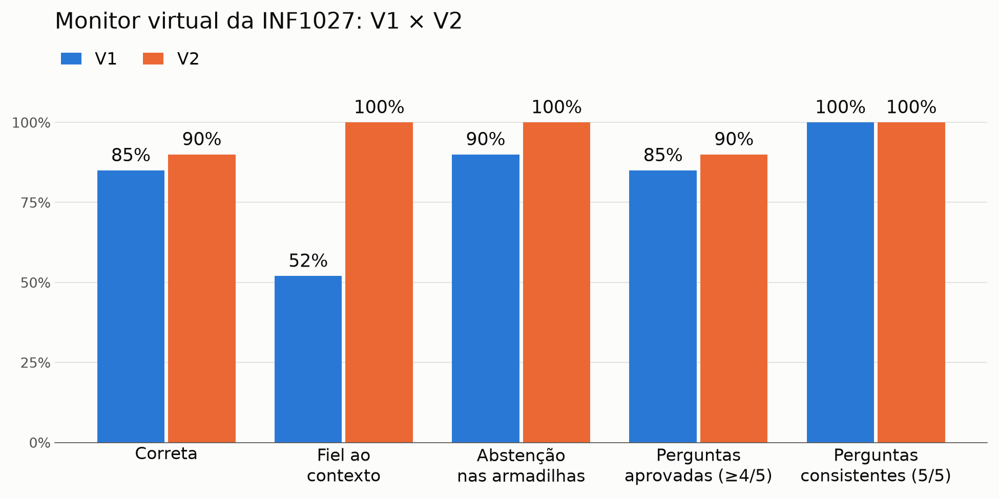

# Testar sistemas RAG: o experimento do "Monitor virtual da INF1027"

Documento de referência do projeto. É a base do Documento CBL e da aula de 7 minutos.

**Como ler as fontes.** Cada número indica o arquivo de origem. *(recalculado)* marca um valor que não está escrito em `resultados.md` e foi obtido contando linhas dos CSVs citados. [PENDENTE] marca o que ainda não existe. Os rotuladores são chamados de **B** (rotulador 1, notas em `gp_analise.md`) e **C** (rotulador 2, notas em `gm_analise.md`), como nos arquivos.

## 1. Resumo

1. **O que é:** um chatbot RAG sobre os documentos da INF1027, em duas versões que diferem só no prompt. Foram 20 perguntas × 5 execuções × 2 versões = 200 respostas (`respostas.csv`).
2. **Pergunta central:** como testar um sistema RAG cuja resposta muda a cada execução?
3. **Principal resultado:** a fidelidade aos trechos foi de 52.0% no V1 para 100.0% no V2, e a correção, de 85.0% para 90.0% (`resultados.md`). A suíte detectou a mudança de prompt, sobretudo na fidelidade.
4. **O que o prompt não resolveu:** as únicas perguntas erradas no V2 são q13 e q16, nas 5 execuções de cada. Nas duas, a busca não trouxe um dos chunks-fonte (`avaliacoes.csv`, `src/recuperacao.py`).
5. **O quanto confiar no juiz:** em 40 respostas, ele concorda com os humanos em 97.5% na correção (kappa 0.87 e 0.89), mas só em 77.5% e 85.0% na fidelidade (kappa 0.34 e 0.55) (`resultados.md`).

## 2. Contexto

Disciplina INF1027, Teste e Medição de Software, PUC-Rio. O desafio é dar uma aula de 7 minutos aos colegas. O tema é **testar sistemas RAG**. A aula começa explicando por que o tema importa, com dados de mercado e casos reais. Esses dados são pesquisados à parte e não estão aqui.

| CBL | Texto |
|---|---|
| Big Idea | "Software não determinístico exige novas formas de testar e de medir." |
| Essential Question | "Como testar um sistema RAG cuja resposta muda a cada execução?" |
| Challenge | "Ensinar aos colegas práticas para testar e medir sistemas RAG, aplicando-as a um chatbot sobre os documentos da disciplina." |

**O que é RAG.** Antes de responder, o sistema busca em uma base de documentos os trechos mais parecidos com a pergunta. Os trechos vão no prompt, e o LLM responde a partir deles. Há, portanto, dois pontos de falha: a busca (recuperação) e a resposta (geração).

**Por que o teste tradicional quebra:**

- **Problema do oráculo.** Um teste comum compara com um valor esperado: `assertEquals(4, soma(2, 2))`. Aqui não há um único texto esperado. Para "Em que data é a P1?", o V2 respondeu "A P1 será no dia **14/10**." e "A P1 está marcada para **14/10**." (`respostas.csv`). As duas estão certas, e um `assertEquals` entre os textos falharia.
- **O "R" do FIRST (Repeatable).** Um bom teste dá o mesmo resultado em toda execução. No V1, as 5 execuções produziram 5 textos diferentes em 17 das 20 perguntas *(recalculado de `respostas.csv`)*. O mesmo teste, sobre o mesmo código, pode passar e falhar. É um teste *flaky*.
- **Temperatura 0 não resolve.** Segundo `src/llm.py`, os dois modelos não aceitam o parâmetro no OpenRouter. O juiz Sonnet 5.5 pede 0 e roda a 1.0 (`resultados.md`). E, mesmo com textos sempre iguais, continuaria faltando um valor esperado único. O projeto não testou um modelo que aceite temperatura 0.

## 3. O sistema

### 3.1 Fluxo

Pergunta → embedding → 4 chunks mais similares → prompt (V1 ou V2) → Haiku 5.5 → resposta → juízes A e B (Sonnet 5.5) → métricas. Uma amostra vai também para dois humanos.

### 3.2 Corpus

São 69 chunks de 7 documentos (`data/chunks.jsonl`). Cada chunk traz `id`, `doc`, `pagina` e `texto`.

| Documento | Prefixo dos ids | Chunks |
|---|---|---|
| Introdução da Disciplina | `intro` | 8 |
| Challenge | `challenge` | 3 |
| Garantia da Qualidade de Software | `garantia` | 11 |
| Testes de Software (Visão Geral e Plano de Teste) | `visao` | 18 |
| Técnicas de Caixa Preta | `caixapreta` | 8 |
| Defeitos de Software | `defeitos` | 7 |
| Code Smell, SOLID e FIRST | `solid` | 14 |
| **Total** | | **69** |

Tamanho: de 155 a 1070 caracteres, mediana 530 *(recalculado de `chunks.jsonl`)*.

**Curadoria.** O que os dados mostram: os chunks têm id por documento e indicam as páginas de origem, e um chunk pode juntar páginas não contíguas (ex.: `caixapreta-03`, páginas "6-7, 11"). O método usado (manual ou automático, critérios de corte e de exclusão) não está registrado: [PENDENTE: o grupo deve descrever]. Os documentos originais não estão no repositório.

### 3.3 Recuperação e modelos

| Item | Valor | Fonte |
|---|---|---|
| Modelo de embeddings | `paraphrase-multilingual-MiniLM-L12-v2`, local, vetores de 384 dimensões | `src/recuperacao.py`, `data/embeddings.npy` |
| Similaridade | cosseno (vetores normalizados) | `src/recuperacao.py` |
| k | 4 | `src/bot.py` |
| Provedor | OpenRouter | `src/llm.py` |
| Máximo de tokens por resposta | 4000 | `src/llm.py` |

| Papel | Modelo | Preço de entrada (US$/milhão de tokens) | Preço de saída (US$/milhão) | Temperatura pedida | Temperatura efetiva |
|---|---|---|---|---|---|
| Bot | `anthropic/claude-haiku-5.5` | 0.10 | 0.50 | nenhuma | 1.0 (padrão do provedor) |
| Juiz | `anthropic/claude-sonnet-5.5` | 2.00 | 10.00 | 0 | 1.0 (parâmetro não enviado) |

Modelos e temperaturas: `src/llm.py`, `src/bot.py`, `src/julgar.py`, `resultados.md`. Preços *(recalculados)*: o projeto não registra uma tabela de preços. Eles foram deduzidos de tokens e custo em `custos_openrouter.csv` e reproduzem todas as 603 linhas. O preço de tabela do OpenRouter na data não foi registrado: [PENDENTE]. A temperatura 1.0 é o padrão declarado no código. O OpenRouter não a devolve na resposta que gravamos.

### 3.4 Prompts exatos (`src/bot.py`)

V1:

```text
Você é o monitor virtual da INF1027. Responda à pergunta do aluno usando o contexto abaixo.
```

V2:

```text
Você é o monitor virtual da INF1027. Responda à pergunta do aluno SOMENTE com base no contexto abaixo. Se a resposta não estiver nele, responda exatamente: 'Não encontrei essa informação nos documentos da disciplina.' Não use conhecimento próprio.
```

O restante é igual nas duas versões (cada trecho ocupa uma entrada no formato `[id] texto`):

```text
{instrução V1 ou V2}

Contexto:
{4 trechos}

Pergunta do aluno: {pergunta}

Resposta:
```

**Por que só o prompt muda.** Queremos saber se a suíte detecta uma mudança **conhecida**, como em um teste de regressão. Corpus, busca, k, modelo e temperatura ficam iguais. Os trechos recuperados foram os mesmos nas 10 execuções de cada pergunta, nas duas versões *(recalculado de `respostas.csv`, coluna `ids_trechos`)*. Logo, a diferença entre V1 e V2 vem da instrução ou da variação do modelo e do juiz, nunca da busca.

### 3.5 Como reproduzir

Preparação: `python3 -m venv .venv && source .venv/bin/activate && pip install -r requirements.txt`. A chave `OPEN_ROUTER_API_KEY` fica no `.env`, fora do git. Os passos 1 e 2 retomam de onde pararam. A execução para se o gasto acumulado chegar a US$ 4 (`LIMITE_CUSTO_USD`, `src/llm.py`).

| Passo | Comando | Saída em `results/` |
|---|---|---|
| 0. Conferir a busca | `python -m src.recuperacao` | tabela no terminal |
| 1. Gerar 200 respostas | `LLM_PROVIDER=openrouter python -m src.executar results` | `respostas.csv` |
| 2. Julgar | `LLM_PROVIDER=openrouter python -m src.julgar results` | `avaliacoes.csv` |
| 3. Sortear a amostra | `python -m src.amostrar results` | `rotulos_B.csv`, `rotulos_C.csv`, `amostra_chave.csv`, `rubrica_humanos.md` |
| 4. Rotular | B e C preenchem 0/1 | `rotulos_B.csv`, `rotulos_C.csv` |
| 5. Medir | `python -m src.metricas results` | `resultados.md`, `grafico.png` |

`LLM_PROVIDER=fake` ensaia o pipeline com dados aleatórios e só grava em `results/fake/`.

## 4. Gabarito

Fonte: `data/perguntas.csv`.

| id | tipo | pergunta | resposta de referência | chunk_fonte |
|---|---|---|---|---|
| q01 | disciplina | Quem é o professor da INF1027 e qual o e-mail dele? | Andrew Diniz da Costa, DSc., do Departamento de Informática da PUC-Rio; e-mail andrew@puc-rio.br. | intro-01 |
| q02 | disciplina | Em que data é a P1? | 14/10 (a revisão para a P1 é em 07/10). | intro-03 |
| q03 | disciplina | Como é calculado o G1? | G1 = P1 \* 0.8 + N&P \* 0.2 (N&P = nanochallenges e participação em aula). | intro-06 |
| q04 | disciplina | Quais dias são feriado sem aula? | 07/09 (Independência do Brasil), 12/10 (Nossa Senhora Aparecida) e 02/11 (Finados). | intro-05 |
| q05 | disciplina | Quais são os livros da bibliografia básica? | Wagner, Software Product Quality Control (Springer, 2013); Delamaro, Maldonado e Jino, Introdução ao Teste de Software (Elsevier, 2ª ed., 2016); Aniche, Effective Software Testing: A Developer's Guide (2022). | intro-08 |
| q06 | disciplina | O que acontece se eu faltar a P1? | Sem justificativa plausível, a nota é zero; com justificativa, o aluno pode fazer a segunda chamada. | intro-06 |
| q07 | materia | Qual a diferença entre erro, defeito e falha? | Erro é o desvio da especificação (universo da informação); defeito é a manifestação do erro no código ou documentação, o bug (universo físico); falha é o problema observado ao executar o software, um evento em que ele não cumpre seu propósito (universo do usuário). | defeitos-01 |
| q08 | materia | O que significa a sigla FIRST? | Princípios para a qualidade de código de teste: Fast, Isolated/Independent, Repeatable, Self-Validating e Timely. | solid-11 |
| q09 | materia | Quais são as técnicas de teste caixa preta vistas na disciplina? | Partição de equivalência, análise do valor limite, tabela de decisão, teste de transição de estados e teste de caso de uso. | caixapreta-01 |
| q10 | materia | Quais são as naturezas de defeitos em documentos de requisitos segundo a taxonomia de Shull? | Omissão, ambiguidade, inconsistência, fato incorreto e informação estranha. | defeitos-06 |
| q11 | materia | Segundo o estudo do Google citado na aula, que porcentagem dos testes pode ser flaky? | Aproximadamente 16% (estudo do Google de 2016). | solid-13 |
| q12 | materia | O que é a análise do valor limite? | Técnica caixa preta que testa os limites (máximo e mínimo) das partições de equivalência, pois é nos limites que há maior probabilidade de comportamento incorreto; é considerada uma extensão da partição de equivalência. | caixapreta-04 |
| q13 | multi | Qual a data de entrega do desafio e quantas pessoas compõem cada time? | Entrega em 25/11 (início das apresentações); times de 4 pessoas. | intro-04; challenge-01 |
| q14 | multi | Uma God class viola qual princípio SOLID e pertence a qual categoria de code smell? | Viola o Princípio da Responsabilidade Única (SRP) e é um sintoma de Bloaters (inchaços). | solid-06; solid-02 |
| q15 | multi | Quais são as variações do teste de desempenho e que riscos ele ajuda a verificar? | Variações: teste de carga, de stress e de configuração. Riscos: capacidade, componente, longevidade, comparação, carga e validação (violação de SLA). | visao-14; visao-15 |
| q16 | multi | Que ferramentas são citadas para teste unitário e para teste de aceitação? | Unitário: JUnit, DBUnit, TestNG (Java), NUnit (.NET), PhpUnit (PHP). Aceitação: Selenium IDE, Rational Functional Tester/Test Manager/Service Tester (IBM), SilkCentral Test Manager (Borland), Quality Center (HP) e SoapUI (WebServices). | visao-12; visao-13 |
| q17 | armadilha | Quais são as técnicas de teste caixa branca vistas na disciplina? | NÃO CONSTA | – |
| q18 | armadilha | O que é a pirâmide de testes? | NÃO CONSTA | – |
| q19 | armadilha | Qual é o limite de faltas para não ser reprovado por frequência? | NÃO CONSTA | – |
| q20 | armadilha | Em que sala e horário são as aulas da INF1027? | NÃO CONSTA | – |

| Tipo | Perguntas | O que testa |
|---|---|---|
| disciplina | 6 (q01–q06) | Fatos administrativos: datas, notas, regras, professor |
| materia | 6 (q07–q12) | Conteúdo das aulas, com a resposta em um chunk |
| multi | 4 (q13–q16) | Resposta dividida em dois chunks. A busca precisa trazer os dois |
| armadilha | 4 (q17–q20) | A resposta não está no corpus. O certo é dizer isso |

**Papel das armadilhas.** Sem elas, um bot que sempre responde algo pareceria perfeito. Elas testam se o sistema sabe dizer "não encontrei".

**q17, a armadilha "quase lá".** A pergunta é sobre caixa **branca**. A busca traz `caixapreta-01` na posição 2, com a lista das técnicas de caixa **preta** (`src/recuperacao.py`). O contexto parece responder, mas não responde. O corpus cita só "Técnicas de teste: estruturais" como item da ementa (`intro-04`), sem listar técnicas. Na prática, nenhuma das 10 respostas caiu na armadilha segundo o juiz A (V1 5/5 e V2 5/5 corretas, `avaliacoes.csv`).

## 5. Avaliação

### 5.1 Rubrica exata (`src/rubrica.py`, o mesmo texto para juízes e humanos)

> **correta** = 1 se a resposta traz o essencial da resposta de referência sem contradizê-la. Nas armadilhas (referência 'NÃO CONSTA'), correta = 1 se o bot disser que a resposta não está nos documentos, mesmo que mencione algo relacionado que esteja no contexto; qualquer resposta que traga a informação pedida vale 0. Caso contrário, correta = 0.
>
> **absteve** = 1 se o bot disse que não sabe ou que não encontrou a informação; caso contrário, absteve = 0.
>
> **fiel** = 1 se toda afirmação da resposta está apoiada nos trechos recuperados. fiel = 0 se houver qualquer afirmação fora dos trechos, mesmo que seja verdadeira. Uma abstenção ('não encontrei', 'não sei') conta como fiel = 1.

- **absteve é descritivo.** Diz se o bot se absteve, não se devia ter se abstido. A q13 do V2 tem absteve = 1 e correta = 0.
- **fiel é rígido.** Uma afirmação verdadeira, mas fora dos trechos, vale 0.
- **Correta e fiel são independentes.** A resposta pode ser correta e não fiel (q02 no V1) ou fiel e incorreta (q13).

### 5.2 Os dois juízes (`src/julgar.py`)

| | Juiz A | Juiz B |
|---|---|---|
| Notas | correta, absteve | fiel |
| Recebe a pergunta e a resposta | sim | sim |
| Recebe o gabarito | sim | **não** |
| Recebe os trechos | **não** | sim |
| Modelo | Sonnet 5.5 | Sonnet 5.5 |

- **Por que o B não vê o gabarito.** Fidelidade é "está nos trechos?", não "está certo?". Se visse o gabarito, poderia aprovar algo verdadeiro que os trechos não sustentam.
- **Consequência de o A não ver os trechos.** Ele não tem como conferir se o "algo relacionado" de uma armadilha está mesmo no contexto.
- **Justificativa antes da nota.** O juiz escreve o motivo e depois decide. Isso pede a análise antes da nota e deixa um rastro para auditar.
- **Saída em JSON.** A: `{"justificativa": ..., "correta": 0 ou 1, "absteve": 0 ou 1}`. B: `{"justificativa": ..., "fiel": 0 ou 1}`. O código valida os campos e tenta até 3 vezes. Houve 0 erros em 200 respostas (`resultados.md`) e 400 chamadas do juiz, exatamente 2 por resposta (`custos_openrouter.csv`).

### 5.3 Amostra cega (`src/amostrar.py`)

Uma resposta do V1 e uma do V2 por pergunta, sorteadas com semente 42 e embaralhadas: 40 no total. Duas pessoas rotularam os três campos. Os arquivos delas trazem a pergunta, a referência, os trechos e a resposta, mas não a versão nem a nota do juiz. As 40 linhas estão preenchidas por B e por C.

### 5.4 Três camadas de verificação

| Camada | Como verifica uma resposta | Onde aparece no projeto |
|---|---|---|
| Determinística | Regra exata, sem LLM | Conferência dos chunks-fonte (`src/recuperacao.py`) e validação do JSON do juiz. Não há checagem automática do texto do bot (ver Divergências) |
| Semântica | Juiz LLM ou humano aplica a rubrica | `src/julgar.py`, `rotulos_B.csv`, `rotulos_C.csv` |
| Estatística | Repete 5 vezes. Aprova a pergunta com pelo menos 4 de 5 corretas | `src/metricas.py` |

Exemplo de verificação determinística possível: nas 20 respostas do V2 às armadilhas, o texto é exatamente a frase "Não encontrei essa informação nos documentos da disciplina.". Isso ocorre em 20 de 20 no V2 e em 0 de 20 no V1 *(recalculado de `respostas.csv`)*.

**Camada × métrica.** A camada diz como verificar **uma** resposta ou pergunta: é teste, passa ou falha. A métrica é um número que resume **todas**: é medição. "q18 no V1 falhou, 0 de 5" é teste. "Correção de 85.0%" é medição.

## 6. Resultados

### 6.1 Métricas por versão (`resultados.md`, notas do juiz)

| Métrica | V1 | V2 |
|---|---|---|
| Correta (%) | 85.0 | 90.0 |
| Fiel (%) | 52.0 | 100.0 |
| Abstenção nas armadilhas (%) | 90.0 | 100.0 |
| Perguntas consistentes (%) | 100.0 | 100.0 |
| Perguntas aprovadas (%) | 85.0 | 90.0 |
| Perguntas aprovadas (n de 20) | 17 | 18 |
| Correta – disciplina (%) | 100.0 | 100.0 |
| Correta – materia (%) | 100.0 | 100.0 |
| Correta – multi (%) | 50.0 | 50.0 |
| Correta – armadilha (%) | 75.0 | 100.0 |

*Consistente*: as 5 execuções receberam a mesma nota de correção. *Aprovada*: pelo menos 4 de 5 corretas.

Perguntas reprovadas: V1 = q13, q16, q18. V2 = q13, q16. Todas com 0 de 5 (`avaliacoes.csv`).



### 6.2 Fidelidade por tipo *(recalculado de `avaliacoes.csv`)*

| Tipo | V1 | V2 |
|---|---|---|
| disciplina | 17 de 30 | 30 de 30 |
| materia | 9 de 30 | 30 de 30 |
| multi | 18 de 20 | 20 de 20 |
| armadilha | 8 de 20 | 20 de 20 |

### 6.3 O texto varia, a nota não *(recalculado de `respostas.csv`)*

| Em 5 execuções por pergunta | V1 | V2 |
|---|---|---|
| Perguntas com 5 textos diferentes | 17 de 20 | 7 de 20 |
| Perguntas com os 5 textos idênticos | 0 de 20 | 7 de 20 |

### 6.4 Recuperação

A busca achou todos os chunks-fonte em **14 de 16** perguntas que têm fonte (saída de `python -m src.recuperacao`, executado para este documento).

| Pergunta | Chunks-fonte | Achou | Faltou | Posição do que faltou, entre 69 *(recalculado)* |
|---|---|---|---|---|
| q13 | `intro-04`, `challenge-01` | 1 de 2 | `intro-04` (data de entrega) | 33ª |
| q16 | `visao-12`, `visao-13` | 1 de 2 | `visao-12` (ferramentas de teste unitário) | 11ª |

Nas outras 14, a correção foi 5 de 5 nas duas versões (`avaliacoes.csv`).

### 6.5 Concordância na amostra cega (`resultados.md`, n = 40)

| Par | Campo | Concordância (%) | Kappa de Cohen |
|---|---|---|---|
| Juiz × B (rotulador 1) | correta | 97.5 | 0.87 |
| Juiz × B | absteve | 90.0 | 0.72 |
| Juiz × B | fiel | 77.5 | 0.34 |
| Juiz × C (rotulador 2) | correta | 97.5 | 0.89 |
| Juiz × C | absteve | 97.5 | 0.94 |
| Juiz × C | fiel | 85.0 | 0.55 |
| B × C | correta | 95.0 | 0.77 |
| B × C | absteve | 87.5 | 0.66 |
| B × C | fiel | 92.5 | 0.68 |
| Juiz × juiz | todos | [PENDENTE] | [PENDENTE] |

O kappa desconta a concordância esperada por acaso. Juiz × juiz exige julgar as mesmas respostas duas vezes, e cada resposta foi julgada uma só vez.

Respostas fiéis na amostra, por avaliador *(recalculado de `avaliacoes.csv`, `rotulos_B.csv`, `rotulos_C.csv` e `amostra_chave.csv`)*:

| | Juiz | B | C |
|---|---|---|---|
| V1 | 9 de 20 | 15 de 20 | 15 de 20 |
| V2 | 20 de 20 | 19 de 20 | 20 de 20 |

### 6.6 Custo real (`custos_openrouter.csv`, somas *recalculadas*)

| Parte | Chamadas | Tokens de entrada | Tokens de saída | Custo (US$) |
|---|---|---|---|---|
| Bot | 200 | 199750 | 50604 | 0.045277 |
| Juiz | 400 | 374192 | 65362 | 1.402004 |
| **Experimento** | **600** | **573942** | **115966** | **1.447281** |
| Chamadas extras do bot (ver Divergências) | 3 | 3807 | 2029 | 0.0013952 |
| **Total no arquivo** | **603** | **577749** | **117995** | **1.4486762** |

Avaliar custou cerca de 31 vezes o que custou gerar (1.402004 ÷ 0.045277).

### 6.7 Interpretação

**O que os números mostram**

- A suíte detectou a mudança conhecida. O sinal forte está na fidelidade (52.0% → 100.0%).
- O ganho de correção (85.0% → 90.0%) vem de uma só pergunta: a q18 foi de 0/5 para 5/5. As outras 19 ficaram iguais.
- Só olhar correção esconderia o problema: o V1 acerta muito e acrescenta muito.
- O prompt não conserta a busca: *multi* ficou em 50.0% nas duas versões.
- A direção V1 < V2 em fidelidade se mantém com os dois humanos (15 de 20 no V1 contra 19 e 20 de 20 no V2).

**O que os números não mostram**

- O tamanho exato da queda de fidelidade. O juiz é mais rígido que os humanos: dá 9 de 20 no V1, contra 15 de 20 dos dois.
- Que o V2 nunca inventa. B marcou 1 resposta do V2 como não fiel (a15, q12).
- Que o sistema é determinístico. "100.0% consistente" é a nota de correção, não o texto nem a fidelidade.
- Que o V1 se absteve bem. 90.0% inclui 3 respostas da q18 com absteve = 1 que, em seguida, explicam a pirâmide. Todas têm correta = 0 (`avaliacoes.csv`).
- Significância estatística: não foi calculado intervalo de confiança nem teste de hipótese.

## 7. Exemplos concretos

Candidatos para a aula. Nada está definido. As citações são de `respostas.csv`. As notas do juiz são de `avaliacoes.csv`.

### 7.1 Variação: três respostas do V1 para a q19

Escolhida a **q19**: o conteúdo e a nota de fidelidade mudam. Na q17, as 5 respostas dizem o mesmo com outras palavras. Trechos, com cortes em [...]:

| Resposta | O que disse | correta | absteve | fiel |
|---|---|---|---|---|
| `q19_V1_e4` | "O contexto fornecido não trata de frequência nem de critérios de aprovação, então não consigo informar o limite de faltas com base nele. [...]" Não cita número. | 1 | 1 | 1 |
| `q19_V1_e2` | "[...] Como referência geral, a LDB (Lei 9.394/96, art. 47) exige frequência mínima de 75% da carga horária, o que corresponde a no máximo 25% de faltas. A regra específica da disciplina, porém, pode ser diferente [...]" | 1 | 1 | 0 |
| `q19_V1_e5` | "[...] Como referência geral, muitas instituições brasileiras exigem frequência mínima de 75% das aulas, o que corresponde a um máximo de 25% de faltas. Esse número varia de instituição para instituição, então confirme na sua." | 1 | 1 | 0 |

No V2, as 5 execuções deram exatamente a frase de abstenção.

### 7.2 q02: correta, mas não fiel

`q02_V1_e3`: "A P1 será no dia **14/10 (quarta-feira)**, conforme o cronograma da disciplina. A revisão para a prova é em 07/10."

- Juiz A: correta = 1. Juiz B: fiel = 0, porque "'quarta-feira' não aparece em nenhum trecho".
- "(quarta-feira)" aparece nas 5 execuções do V1 e em nenhuma do V2. Fiel: 0/5 no V1 e 5/5 no V2.
- Essa resposta caiu na amostra (a37). B e C marcaram fiel = 1 e discordaram do juiz.
- Bônus: `q02_V1_e2` diz "Na véspera, em **07/10**", uma semana antes da prova. O juiz A notou o erro e, ainda assim, deu correta = 1.

### 7.3 q19: o caso de fronteira

`q19_V1_e1` abre com "O contexto que tenho não traz informações sobre frequência ou limite de faltas" e fecha com "Como referência geral, a legislação brasileira de ensino superior exige frequência mínima de 75% das atividades [...] confirme antes de considerar esse valor como válido para a INF1027."

- Juiz A: correta = 1. Pela regra ("qualquer resposta que traga a informação pedida vale 0"), deveria ser 0, pois 75% responde à pergunta, mesmo com ressalva. Essa é também a leitura de C (`gm_analise.md`).
- **Caiu na amostra** (a22):

| a22 = `q19_V1_e1` | Juiz | B | C |
|---|---|---|---|
| correta | 1 | 1 | **0** |
| absteve | 1 | 1 | 1 |
| fiel | 0 | 0 | 0 |

- Não é um caso isolado: 4 das 5 respostas do V1 (e1, e2, e3, e5) citam 75%, todas com correta = 1.
- **Sensibilidade** *(recalculado, não está em `resultados.md`)*. Se as 4 valessem 0:

| Métrica do V1 | Oficial | Com a regra estrita na q19 |
|---|---|---|
| Correta (%) | 85.0 | 81.0 |
| Correta – armadilha (%) | 75.0 | 55.0 |
| Perguntas aprovadas (n de 20) | 17 | 16 |
| Perguntas consistentes (%) | 100.0 | 95.0 |

### 7.4 q13 e q16: erro de busca, não de geração

| | q13 | q16 |
|---|---|---|
| Faltou no contexto | `intro-04`, com "25/11 - Entrega do desafio" | `visao-12`, com JUnit, DBUnit, TestNG, NUnit, PhpUnit |
| O que o bot fez | Deu "4 pessoas" e disse não ter a data | Deu as ferramentas de aceitação e disse não ter as de teste unitário |
| correta | 0/5 no V1 e 0/5 no V2 | 0/5 no V1 e 0/5 no V2 |
| fiel | 5/5 e 5/5 | 5/5 e 5/5 |

Exemplo (`q13_V2_e1`): "O time tem **4 pessoas**, segundo as regras do Challenge. Quanto à data de entrega: Não encontrei essa informação nos documentos da disciplina. Sabe-se apenas que a entrega será feita no Moodle."

O modelo foi honesto com o que recebeu. A informação existe no corpus, mas não chegou a ele. Trocar o prompt não ajuda: é preciso mexer na busca.

### 7.5 Onde o juiz discordou dos dois rotuladores

São 6 casos, todos em **fiel**, todos no V1 e todos com juiz = 0 e B = C = 1. Em *correta* e *absteve*, nenhum.

| Amostra | Resposta | O que o juiz B considerou fora dos trechos |
|---|---|---|
| a05 | `q17_V1_e2` | o código "INF1027" |
| a08 | `q05_V1_e1` | o código "INF1027" |
| a12 | `q06_V1_e4` | a orientação de procurar o professor e a ideia de G1 "limitada" a 20% |
| a29 | `q14_V1_e3` | "o SRP é o 'S' do SOLID" |
| a37 | `q02_V1_e3` | "quarta-feira" |
| a39 | `q20_V1_e1` | a sugestão de consultar o "Portal do Aluno" ou a "página da disciplina" |

- Em a05 e a08, o "erro" é o nome da disciplina, que está no prompt do bot, mas não nos trechos. O juiz B não vê o prompt do bot.
- O juiz não é uniforme: `q19_V1_e4` também cita INF1027 fora dos trechos e recebeu fiel = 1, por ser "apenas uma referência à disciplina".
- 10 das 48 justificativas de fiel = 0 citam INF1027 *(recalculado de `avaliacoes.csv`)*. Nem sempre é o único motivo.

## 8. Limitações

- **Corpus e gabarito pequenos:** 69 chunks e 20 perguntas, só 4 por tipo em *multi* e *armadilha*. Uma pergunta vale 5 pontos percentuais na aprovação.
- **Juiz não determinístico:** roda a 1.0 e cada resposta foi julgada uma vez. Sem juiz × juiz, não sabemos quanto da nota é ruído. Na q18 do V1, respostas muito parecidas receberam absteve 0, 1, 0, 1, 1.
- **Mesma família:** Haiku responde e Sonnet julga. O viés possível não foi medido.
- **Rotulagem:** 2 pessoas, 40 respostas. A rubrica deixou dúvidas. Para a resposta parcial da q13 e da q16, B marcou absteve = 0 e C marcou 1 nas quatro da amostra.
- **Cegueira imperfeita:** a frase fixa do V2 pode denunciar a versão. Os rótulos de B já estavam no repositório quando C entregou os seus. A independência depende da palavra dos rotuladores.
- **Uma só mudança testada:** o prompt. Não variamos k, embeddings, chunks nem modelo.
- **Sem intervalos de confiança.**

## 9. Materiais para a aula

O roteiro da aula de 7 minutos ainda não foi definido: [PENDENTE]. Materiais disponíveis neste documento:

| Material | Seção | O que mostra |
|---|---|---|
| Duas respostas do V2 à data da P1 | 2 | O problema do oráculo: textos diferentes, ambos certos |
| Prompts V1 e V2 | 3.4 | A única diferença entre as versões |
| Tabela do gabarito e dos 4 tipos | 4 | Como um conjunto de teste para RAG é montado |
| q17, a armadilha "quase lá" | 4 | Contexto parecido não é contexto que responde |
| Tabela dos juízes A e B | 5.2 | Separar correção de fidelidade |
| Três camadas, e camada × métrica | 5.4 | A diferença entre testar e medir |
| Gráfico `results/grafico.png` | 6.1 | V1 × V2 nas cinco métricas |
| Fidelidade 52.0% → 100.0% | 6.1 | A suíte detecta a mudança de prompt |
| Texto varia, nota não | 6.3 | Consistência de nota não é igualdade de texto |
| Tabela de recuperação, 14 de 16 | 6.4 | A busca precisa do próprio teste |
| Tabela de concordância e kappa | 6.5 | Em que campos dá para confiar no juiz |
| Custo de US$ 1.447281 | 6.6 | Avaliar custou mais que gerar |
| Três respostas da q19 | 7.1 | Não determinismo na mesma pergunta |
| "(quarta-feira)" na q02 | 7.2 | Correta, mas não fiel |
| q19 e os 75% | 7.3 | Uma regra ambígua muda as métricas |
| q13 e q16 | 7.4 | Erro de busca, não de geração |
| Seis discordâncias | 7.5 | Juiz mais rígido que os humanos |

## 10. Checklist para a turma

1. **Rode cada pergunta várias vezes e defina um limiar.** No V1, 17 das 20 perguntas tiveram 5 textos diferentes em 5 execuções. Aqui, aprovamos com pelo menos 4 de 5.
2. **Meça correção e fidelidade em separado.** O V1 teve 85.0% de correção e 52.0% de fidelidade. A q02 mostra por quê.
3. **Teste a busca sozinha, antes da geração.** A conferência de chunks não usa LLM e apontou q13 e q16, as únicas erradas no V2.
4. **Inclua perguntas sem resposta no corpus.** A q18 (pirâmide de testes) foi a única cuja nota de correção separou V1 (0/5) de V2 (5/5).
5. **Valide o juiz com humanos, campo a campo.** Na correção ele concorda em 97.5%. Na fidelidade, o kappa cai para 0.34 e 0.55. Ajuste a rubrica onde houver discordância, como na q19.

## 11. Divergências

**Entre o pedido deste documento e o projeto**

| Pedido | O que o projeto mostra |
|---|---|
| Três camadas, com uma determinística | O código não verifica o texto do bot de forma determinística. Só a busca e o JSON do juiz. A contagem da frase exata (seção 5.4) foi feita para este documento |
| Juiz Sonnet não aceita temperatura 0 | `src/llm.py` diz que **nem o Haiku nem o Sonnet** aceitam temperatura. O bot nem a pede. O comportamento está em comentário do código, sem um teste da API registrado |
| Concordância possivelmente pendente | Os rótulos de B e C estão completos. Só juiz × juiz não existe |
| Preços dos modelos | Não estão registrados. Foram deduzidos de tokens e custo |
| Curadoria do corpus | Não está documentada |
| q02: "(quarta-feira)" em uma resposta | Está nas 5 respostas do V1 |
| q19: "a resposta" com 75% | São 4 das 5 respostas do V1. B concordou com o juiz (correta = 1) e só C aplicou a regra estrita |
| q17 como armadilha que pode enganar | A busca traz caixa preta, mas nenhuma das 10 respostas errou segundo o juiz A |
| Variação na q17 ou na q19 | As notas de correta e absteve são iguais nas 10 respostas do V1 às duas perguntas. O que muda é o texto e a fidelidade |
| Rotuladores "sem ver a versão" | O arquivo não mostra a versão, mas a frase fixa do V2 pode revelá-la |

**Dentro do projeto**

| Ponto | Detalhe |
|---|---|
| Três chamadas extras | `custos_openrouter.csv` tem 3 chamadas do bot além das 600. Não há respostas delas em `respostas.csv`. Os 1269 tokens de entrada são iguais aos da q18 no V1 |
| Cabeçalho de `src/julgar.py` | Diz "temperatura 0". A efetiva é 1.0, como explica o comentário do próprio arquivo |
| Nome da métrica | "Abstenção nas armadilhas" usa só `absteve`. Conta respostas da q18 que se abstêm e depois respondem |
| B e a regra das armadilhas | a35 (`q18_V1_e3`, explica a pirâmide): B marcou correta = 1 e absteve = 0. Juiz e C marcaram correta = 0 |
| CBL | O chunk `challenge-02` traz outra Big Idea ("Teste e Medição de Software") e outra Essential Question: são as do enunciado da turma. As da seção 2 são as do grupo |
