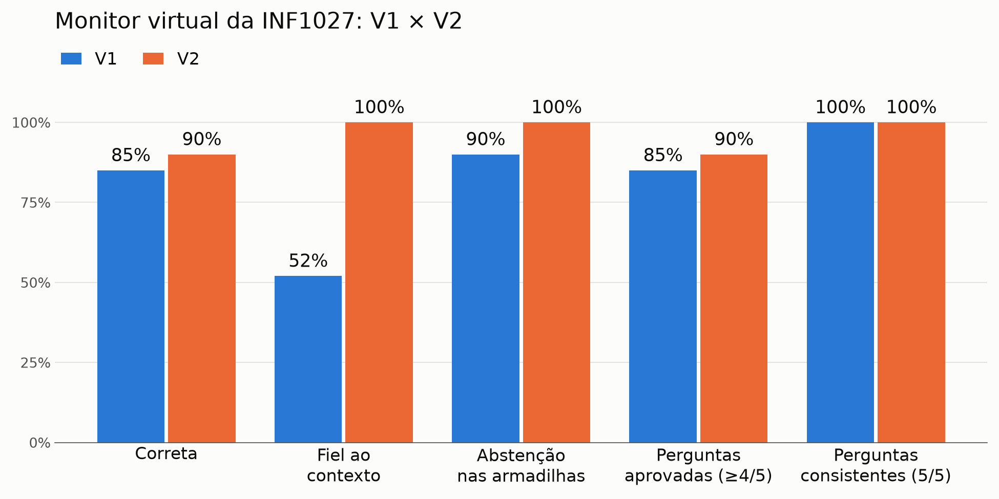

# Resultados — Monitor virtual da INF1027

- Bot: `anthropic/claude-haiku-5.5` · temperatura: 1.0 (padrão do provedor)
- Juiz: `anthropic/claude-sonnet-5.5` · temperatura pedida 0, efetiva 1.0 (o modelo não aceita temperatura; o juiz não é determinístico)
- Respostas: 200 · avaliadas: 200 · com erro do juiz: 0
- Perguntas: 20 · execuções por pergunta e versão: 5

## Por versão

| Métrica | V1 | V2 |
|---|---|---|
| Correta (%) | 85.0 | 90.0 |
| Fiel (%) | 52.0 | 100.0 |
| Abstenção nas armadilhas (%) | 90.0 | 100.0 |
| Consistentes (%) | 100.0 | 100.0 |
| Aprovadas (%) | 85.0 | 90.0 |
| Aprovadas (n) | 17 | 18 |
| Correta – disciplina (%) | 100.0 | 100.0 |
| Correta – materia (%) | 100.0 | 100.0 |
| Correta – multi (%) | 50.0 | 50.0 |
| Correta – armadilha (%) | 75.0 | 100.0 |

*Consistentes*: perguntas em que as 5 execuções receberam a mesma nota de correção. *Aprovadas*: pelo menos 4 de 5 execuções corretas.

## Concordância na amostra cega (40 respostas)

| Par | Campo | Concordância (%) | Kappa de Cohen | n |
|---|---|---|---|---|
| Juiz × B | correta | 97.5 | 0.87 | 40 |
| Juiz × B | absteve | 87.5 | 0.64 | 40 |
| Juiz × B | fiel | 77.5 | 0.34 | 40 |
| Juiz × C | correta | 97.5 | 0.89 | 40 |
| Juiz × C | absteve | 97.5 | 0.94 | 40 |
| Juiz × C | fiel | 85.0 | 0.55 | 40 |
| B × C | correta | 95.0 | 0.77 | 40 |
| B × C | absteve | 85.0 | 0.58 | 40 |
| B × C | fiel | 92.5 | 0.68 | 40 |

`n` = itens com nota válida nos dois lados (rótulos vazios ou erros ficam de fora).

## Gráfico

